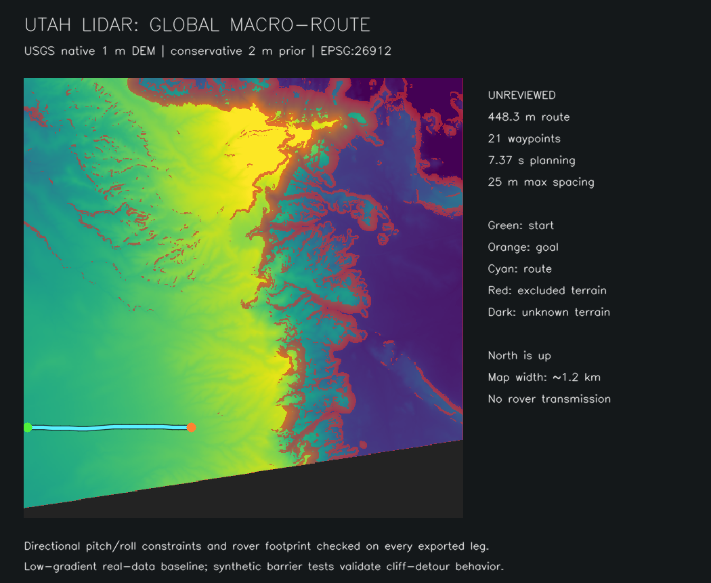

# Global LiDAR planning: first implementation milestone

The roadmap is [LIDAR_NAVIGATION_ROADMAP.md](LIDAR_NAVIGATION_ROADMAP.md). This
milestone provides **offline GeoTIFF preprocessing and unreviewed macro-route
planning**. It does not implement operator approval, radio transmission, PLY
classification, geospatial-to-odom registration, or local terrain fusion yet.

## Real Utah development data

The pinned [USGS tile](https://prd-tnm.s3.amazonaws.com/StagedProducts/Elevation/1m/Projects/UT_StatewideSouth_2020_A20/TIFF/USGS_1M_12_x51y426_UT_StatewideSouth_2020_A20.tif)
is `UT_StatewideSouth_2020_A20`, near Hanksville/MDRS, Utah. It is a
**native 1 m LiDAR-derived elevation raster**, not 10–20 cm data. The catalog
listed 285,961,785 bytes; the fetched object is 237,125,773 bytes. The manifest
records the exact SHA-256, dimensions, CRS (NAD83 / UTM 12N, EPSG:26912), source,
and crop used below. No synthetic cliffs or terrain edits are applied.

The MDRS coordinate itself lies in a nodata gap in this particular survey tile.
The baseline area is a surveyed region north of it. Unknown terrain is blocked,
not filled or interpolated to fabricate a route. Neither the downloaded raster
nor generated memory-mapped arrays are committed to Git.

```sh
python3 -m pip install -e '.[terrain,test]'
python3 scripts/fetch_utah_dem.py
python3 scripts/plan_global_route.py prepare data/utah/mdrs_1m.tif \
  terrain_artifacts/mdrs-north --resolution 2 --vertical-scale 1 \
  --bounds 517200 4252000 518400 4253200
python3 scripts/plan_global_route.py plan terrain_artifacts/mdrs-north \
  routes/mdrs-north.json --start 517211 4252246 --goal 517659 4252246 \
  --radius 0.8 --margin 100 --spacing 25 --timeout 45
```

These coordinates are **projected metres**, not latitude/longitude or ROS odom.
Explicitly confirm the input's elevation units; `--vertical-scale 1` selects
metres for the development DEM. The TIFF itself does not declare vertical units.
Geographic rasters and rotated/flipped grids are rejected pending explicit
reprojection. Feet-based CRSs also require explicit reprojection to a metre-based CRS, so
coordinate values cannot silently disagree with the declared EPSG axis units.
The importer will not upsample a coarse source to pretend it has finer resolution.

## Memory and terrain representation

The importer reads native-resolution windows with a one-pixel halo. GDAL's input
cache is capped at 32 MiB; source blocks over 64 MiB require retiling as a COG; completed output rows are flushed and mapped pages
released where the OS supports it. Output is separate numeric `.npy` arrays and
JSON metadata, opened read-only with memory mapping and `allow_pickle=False`.

The prior contains elevation, maximum slope, hard exclusions, and lower/upper
bounds of each gradient component. Every native pixel contributes to its macro
cell: **any hard cliff, nodata, or unknown derivative blocks that cell**. Gradient
extrema are retained rather than averaging away an unsafe cross-slope. Combined
component bounds and circular footprint checks are conservative and can reject
some physically feasible passages; this is preferable to inventing a safe one.

The full 10,012 × 10,012 pixel tile was processed into 4 m macro cells in about
5.9 seconds with 127,164 KiB peak process RSS in the local ROS container. The
baseline route uses a separate 2 m prior over a ~1.2 km crop. These are development
measurements on this machine, not a guarantee for every 1 GB source. See the
recorded benchmark JSON under `datasets/utah/`.

## Directional planning and safety behavior

For horizontal unit heading `(vx, vy)` and terrain gradient `(gx, gy)`:

- longitudinal tangent/pitch: `gx*vx + gy*vy`;
- lateral tangent/roll: `-gx*vy + gy*vx`;
- direction-specific hard limits on ascent, descent, and absolute roll;
- segment cost is metric distance integrated through every intersected cell,
  with separate uphill, downhill, and roll penalties.

Defaults are a 22° total-slope hard cap, 22° ascent/descent, and 15° roll. They
are configurable model parameters, not measured rover traction/stability limits.
Gradient bounds are checked over the rover footprint as well as every touched
cell. Supercover tracing rejects corner cutting and thin hazards between
waypoints. Parent shortcuts are compared against the route via the current node,
so visibility alone cannot force a more expensive shortcut. Theta* remains an
any-angle heuristic search; no global-optimality claim is made.

Search is restricted to the start/goal bounding rectangle plus `--margin`.
No route in this window is not proof that no route exists anywhere in the map.
Budget exhaustion raises a distinct error. Blocked endpoints are never cleared,
coordinates are never clamped into the map, and a failed static route cannot fall
back to an isotropic direct path. The controller now holds stopped instead of
shrinking rover clearance or retaining a previous controller after rejection.

Sparse export preserves all bends and subdivides long safe segments to a maximum
spacing; it never shortcuts across hazards. Tight terrain may therefore require
waypoints closer than 15 m. The baseline produced a 448.3 m route with 21 points
in about 7.4 seconds, with every output leg checked by the same directional model.
This was a low-gradient feasible development corridor, not a demonstrated global
cliff detour on the real data; synthetic barrier tests cover that behavior.

Output includes map identity, CRS, limits, footprint radius, route hash, and
`review_status: unreviewed`. No approval or radio-send operation exists yet.
A 21-point route is not claimed to fit a single ~100-byte radio packet; packet
encoding and multi-packet reassembly are a subsequent milestone.

## Validation and remaining integration

Run `pytest -q tests` inside the existing ROS environment for the full autonomy
suite, or `pytest -q tests/test_directional_planner.py tests/test_dem.py` for the
ROS-independent terrain tests. Tests cover direction asymmetry, thin hazards,
footprint gradients, corner cutting, safe detours, blocked/unknown endpoints,
no weak fallback, bounded search, native-resolution hazard preservation, tile
seams, and CRS/nodata handling.

The old Gauntlet simulation evidence is explicitly baseline-only. Its route is
refused under the stricter directional/clearance model; the original demo branch
is preserved. A new full acceptance course must validate planner, registration,
controller swept path, and real contacts together.

Next: ground-classified PLY ingestion; frontend map/job/route review with edited
leg validation and explicit approval; a radio-sized mission codec; then the
10 m × 10 m OAK-D directional overlay and local-controller integration.


